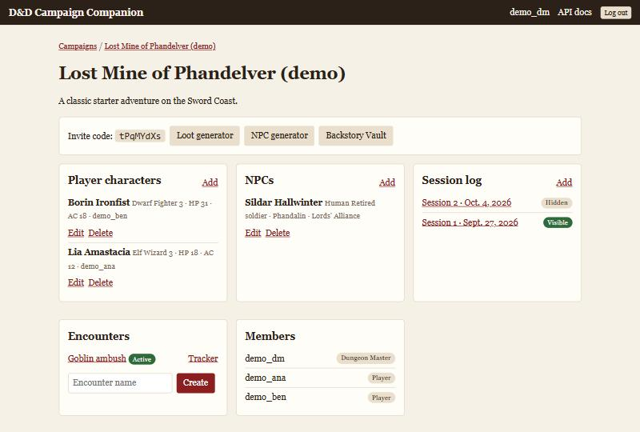
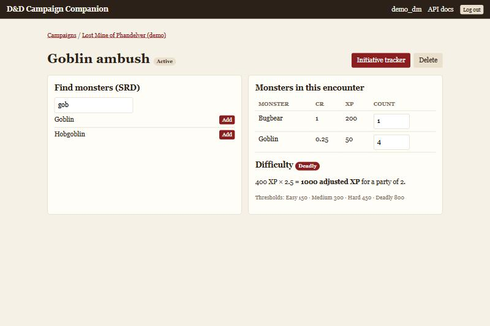
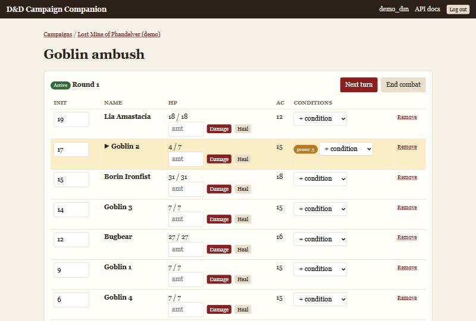
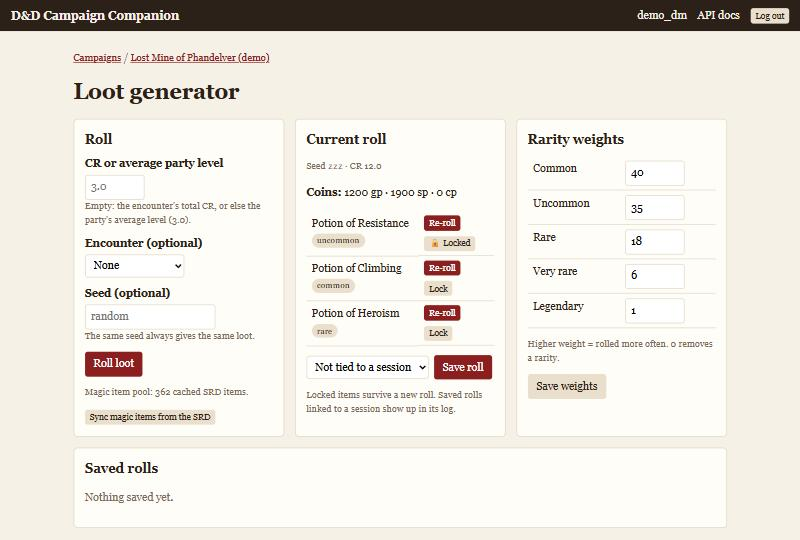
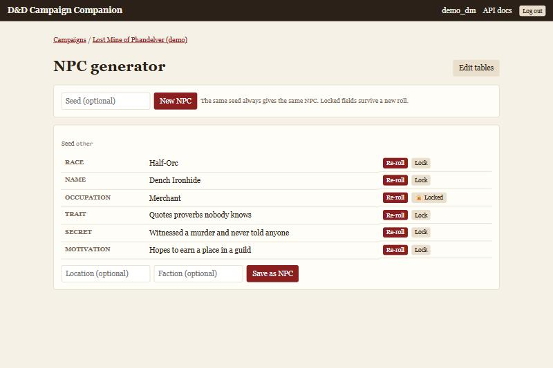
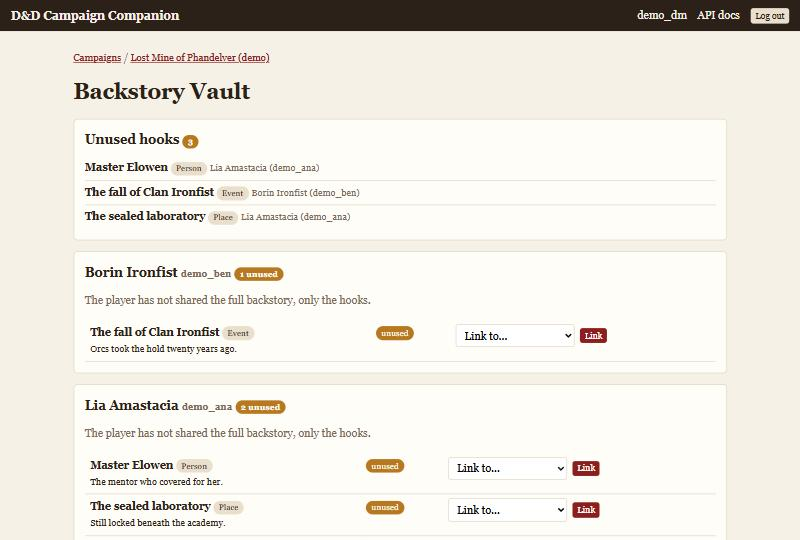

# D&D Campaign Companion

A Django web app for running a D&D 5e campaign. The Dungeon Master manages the
campaign; players only see what the DM releases. It includes an encounter
builder with difficulty rating, a live initiative tracker, a seeded loot
generator, an NPC generator and a Backstory Vault where players record story
hooks for the DM to use.



## Screenshots

| Encounter builder | Initiative tracker |
| --- | --- |
|  |  |

| Loot generator | NPC generator |
| --- | --- |
|  |  |



## Features

| Area | What it does |
| --- | --- |
| Accounts and roles | Register, log in, create a campaign (you become DM) and invite players with a code. |
| Characters and session log | CRUD for player characters and NPCs; session notes with a per-session "visible to players" switch. |
| Encounter builder | Search SRD monsters, add them to an encounter and see Easy / Medium / Hard / Deadly for the current party. |
| Initiative tracker | HTMX tracker: initiative order, next turn, rounds, damage and healing, conditions. Players get a live read-only view. |
| Loot generator | Coins by CR range plus 0-3 SRD magic items weighted by rarity. Seeded, with re-roll and lock per item, per-campaign rarity weights and per-item player visibility. |
| NPC generator | Name (by race), occupation, trait, secret and motivation from weighted tables. Seeded, re-roll or lock per field, save as an NPC. |
| Backstory Vault | Players write a backstory and add hooks; the DM links hooks to NPCs, sessions or encounters and sees which are still unused. |
| REST API | Token-authenticated DRF API with the same permission rules, documented with OpenAPI / Swagger. |

## Quick start

```bash
python -m venv .venv
.venv\Scripts\activate            # Windows; use `source .venv/bin/activate` elsewhere
pip install -r requirements-dev.txt
python manage.py migrate
python manage.py seed_demo        # optional: demo campaign, DM and two players
python manage.py sync_srd         # optional: cache SRD magic items for the loot generator
python manage.py runserver
```

Open http://localhost:8000. The demo accounts are `demo_dm`, `demo_ana` and
`demo_ben`; their password is `DEMO_PASSWORD` in
`campaigns/management/commands/seed_demo.py`.

SQLite is the default database. To use PostgreSQL, install `psycopg` and set
`POSTGRES_DB`, `POSTGRES_USER`, `POSTGRES_PASSWORD`, `POSTGRES_HOST` and
`POSTGRES_PORT`. For anything beyond local development also set
`DJANGO_SECRET_KEY`, `DJANGO_DEBUG=0` and `DJANGO_ALLOWED_HOSTS`.

## Tests

```bash
pytest
ruff check . && ruff format --check .
```

The suite covers:

- **Difficulty** - the worked examples from the DMG / SRD, every multiplier band and the party-size adjustment.
- **Loot and NPC generators** - a fixed seed gives a fixed result, weights shift the distribution, locked entries survive re-rolls.
- **Permissions** - players cannot see or change DM data, in the web app and in the API; the DM cannot read an unshared backstory.
- **Hooks** - the unused-hooks filter follows linking and unlinking.
- **SRD client** - HTTP is mocked; cache hits, expiry, stale fallback and error handling.
- **Initiative tracker** - turn order, rounds, HP clamping, conditions and the HTMX endpoints.

## Architecture

```
config/       settings and root URLconf
accounts/     registration (login/logout use Django's auth views)
campaigns/    Campaign, Membership, Character, GameSession
              access.py    - every role and object-level rule, used by web and API
              services.py  - create / join campaign
srd/          CachedSRDEntry and client.py (SRD API with a database cache)
encounters/   Encounter, EncounterMonster, Combatant
              services/difficulty.py - pure difficulty maths
              services/tracker.py    - turn order, HP, conditions
loot/         LootTable, LootRoll; services.py is the pure, seeded generator
npcs/         NpcTraitTable; services.py is the pure, seeded generator
vault/        Backstory, Hook, HookLink; services.py holds visibility and linking rules
api/          DRF serializers, viewsets and OpenAPI schema
templates/    server-rendered pages and HTMX partials (files starting with "_")
tests/        pytest suite
```

Design choices worth knowing:

- **Business logic lives in services, not views.** The difficulty calculator
  and both generators are pure functions over plain data: no database, no HTTP.
  Views fetch the inputs, call the service and render the result.
- **One set of access rules.** `campaigns/access.py` decides who sees what.
  Web views use the `campaign_view` decorator and the `visible_*` querysets;
  the API viewsets use the same querysets, so both front ends stay in step.
  Non-members get a 404, members without the DM role get a 403.
- **Reproducible randomness.** Every roll runs on `random.Random(seed)`. A
  re-roll is seeded from the original seed, the slot and the re-roll count, so
  re-rolls are reproducible as well. When no seed is given one is generated
  and stored with the result.
- **SRD API with a cache.** `srd/client.py` looks in `CachedSRDEntry` first,
  then calls the API, and falls back to a stale entry when the API is down.
  Only a miss with no cached copy raises `SRDError`, which views turn into a
  message instead of a crash.
- **HTMX instead of a front-end build.** Tracker, builder and generators post
  small requests and swap in a re-rendered partial. The player's tracker polls
  the same partial every three seconds.

### Permission summary

| Data | DM | Player |
| --- | --- | --- |
| Characters | all, including NPCs | own character only |
| Session notes | all | sessions marked visible |
| Encounters | full control | active and finished ones, read-only tracker |
| Loot rolls | full control | only revealed coins and items |
| NPC generator, loot generator | yes | no |
| Backstory text | only when the player shares it | own |
| Hooks | read and link | own: create, edit, delete |

## API

Interactive docs are at `/api/docs/` and the schema at `/api/schema/`.

```bash
curl -X POST http://localhost:8000/api/auth/token/ -d "username=demo_dm&password=..."
curl -H "Authorization: Token <token>" http://localhost:8000/api/campaigns/
```

| Endpoint | Notes |
| --- | --- |
| `/api/campaigns/` | plus `POST /api/campaigns/join/` with an invite code |
| `/api/characters/` | `?campaign=<id>` filter |
| `/api/npcs/` | DM only; `POST /api/npcs/generate/` with optional `seed` and `save` |
| `/api/encounters/` | `POST {id}/monsters/` adds an SRD monster, `GET {id}/difficulty/` rates it |
| `/api/loot-rolls/` | `POST /api/loot-rolls/generate/` with optional `cr`, `encounter`, `seed` |
| `/api/hooks/` | `?unused=true` filter, `POST {id}/link/` for the DM |

## Notes

- Monster and magic item data comes from the [D&D 5e SRD API](https://www.dnd5eapi.co).
- The coin scale in `loot/services.py` is a simple homebrew table per CR range, easy to adjust.
- The model called `Session` in the original design is named `GameSession` to avoid confusion with Django's own session model.
